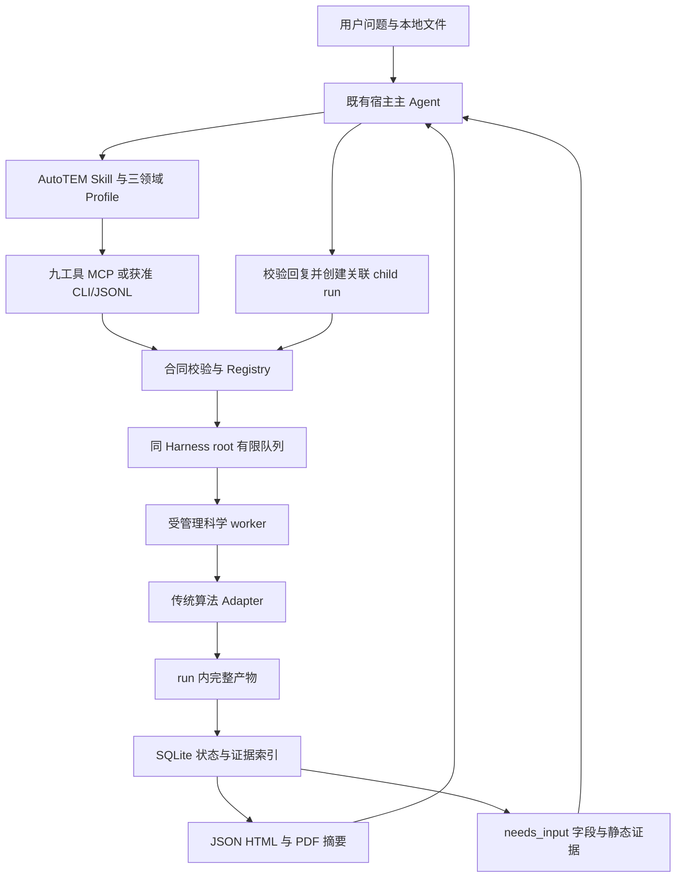
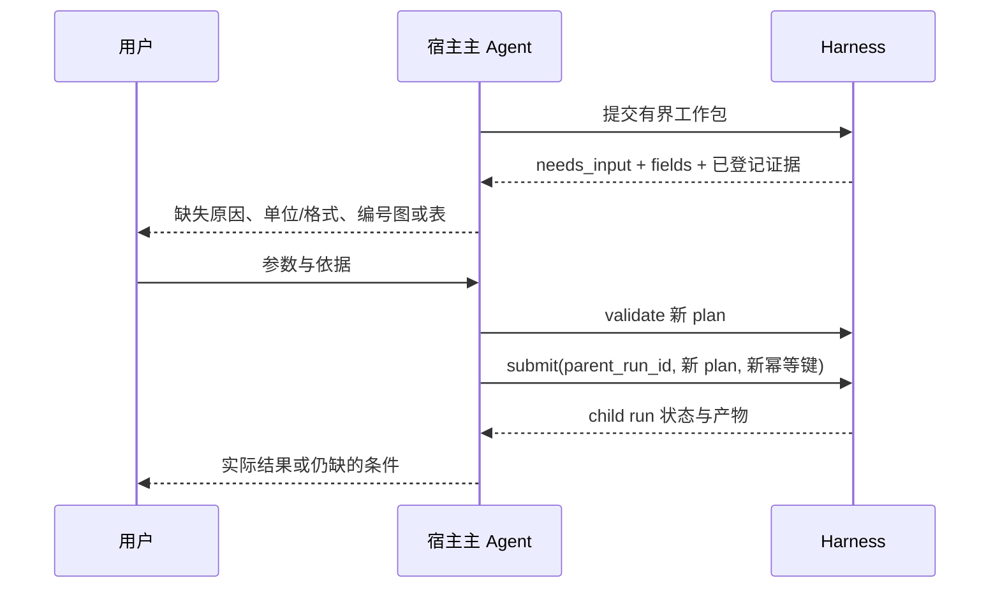
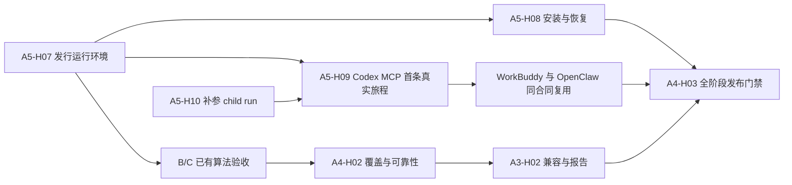

# AutoTEM 传统算法 Skill：运行时发行、三宿主接入与全链路验收技术开发文档

| 项目 | 内容 |
|---|---|
| 文档版本 | 1.0，开发实施设计 |
| 编制日期 | 2026-11-12，Asia/Shanghai |
| 阶段范围 | headless 传统算法、现有操作、Skill/Profile/Harness、安装与三宿主真实调用 |
| 实施主责 | A：leima-max；B：wangzhe221；C：yswgityes |
| 源码检查基线 | HEAD `561da8dba90836d40120f43e5809b3bea38490ff`，另有未提交及未跟踪实现；该提交不能单独复现工作区 |
| 本次核查 | 读取源码、合同、已有证据和官方接口资料；没有重跑算法、安装、三宿主或全仓回归 |
| 发布结论 | 完整链路验收尚未闭合；本文件是下一阶段实施依据，不是完成证明 |

## 1. 目标、范围与文档关系

### 1.1 交付目标

交付可重复安装的传统算法版本。普通用户完成一次安装和宿主首次授权后，通过自然语言及本地文件发起分析；主 Agent 发现能力、选择领域流程、询问必要科学参数，调用真实工具，最终依据登记产物回答。

```text
安装发行包 → 私有运行环境 → 宿主 Skill/工具接入 → 用户问题与本地文件
  → 数据质量/标定 → 按需衍射、原子或应变 → Harness 执行与产物登记
  → 必要时 needs_input → 用户回复 → 关联新 run → 报告与证据回答
```

“链路完整”限定于发行清单声明的输入、操作、宿主版本和条件。缺科学前提时诚实停止并请求补参，也属于正确流程；它不等于已经完成用户所需测量。运行完成、工具可达与科研精度分别判断。

### 1.2 本阶段做什么

- 冻结目标运行环境与完整依赖；提供离线发行、普通用户安装、诊断、恢复及受保护升级/回滚。
- 验证 Codex、WorkBuddy、OpenClaw 的实际 Skill 发现、工具调用、领域协作和返回。优先闭合 Codex、WorkBuddy，随后闭合 OpenClaw；三者均是本阶段最终验收范围。
- 补齐参数问答、child run、证据引用和失败处理；逐项验收已有传统操作。
- 迁移明确支持的旧入口，完善从发行包启动的 CI 和发布证据。

### 1.3 本阶段延期与长期要求

深度学习训练/推理、统一分析前端、未开发科学模块、交互 Revision/CAS、跨 run 自动缓存继续延期。能力 ID 和扩展合同保留，不能以空产物代替实现。

本阶段 headless 是用户明确选择，优先于长期产品文档中的默认工作台启动要求；长期要求不删除。本阶段通过只代表传统链路阶段通过，不代表原完整产品 G1、工作台或科研精度准入全部完成。安装启动器属于部署入口，不包含分析工作台建设。

### 1.4 依据与分工

| 文档 | 本文件的使用方式 |
|---|---|
| [项目技术总览](PROJECT_TECHNICAL_DEVELOPMENT_GUIDE.md) | 保留长期全产品架构；本文件细化本阶段交付 |
| [产品规格](autotem-local-product-spec.md) | 保留长期需求，明确本阶段延期项 |
| [实施状态](harness-implementation-status.md) | 历史完成子范围与未关闭门槛 |
| [安装改进](harness-installation-experience.md)、[宿主适配](harness-host-adapters.md) | 已有 bootstrap/doctor/资源安装及其边界 |
| [A/B/C 分工](../configs/three-person-module-distribution.md)、[原任务板](../configs/team-responsibility-task-board.md) | 人类责任与历史任务，不覆盖原完成记录 |
| [B 操作盘点](harness-operation-inventory-b.md)、[C 操作盘点](harness-operation-inventory-c.md) | 已有算法、操作脚本及 UI 纯计算的注册去向 |

本文中的“现有”来自本次源码阅读；“历史已验证”来自有日期的已有证据；“目标/新增”必须后续开发验收。文中建议新增的路径不是现有文件或可执行命令。

## 2. 当前基线与缺口

### 2.1 已有底座

| 层 | 现有实现 | 下一阶段缺口 |
|---|---|---|
| Registry/Services | 静态定义 37 implemented、12 reserved；受控 handler、严格参数、插件入口 | 建立逐操作证据清单；发行环境中的实际可用性重测 |
| Harness | SQLite、同 root 队列/worker、工作包、全数组产物、报告 | 跨真实宿主完整验证；补参关联记录与发行运行时绑定 |
| 公开工具 | 九工具 JSON CLI、JSONL、可选 stdio MCP | 宿主实际连接与全工具用户旅程，而非仅本地协议测试 |
| bootstrap | 标准库入口、项目私有 venv、离线优先、包来源/依赖/工具检查 | 完整锁定依赖、免 Python 安装启动器、运行时升级/卸载 |
| doctor | 运行环境、本地 MCP、宿主 CLI、OpenClaw 健康及下一动作 | 宿主发现、权限与真实 LLM 旅程须另行取证 |
| 宿主资源 | Skill、Profile、Codex 模板、连接提议及资源回滚 | 模板激活、WorkBuddy GUI、OpenClaw 真实接入 |
| 旧入口 | 新 Harness 入口统一；旧默认组合 API/CLI 保留 | 支持范围内迁移到同服务，保留旧 strict 结果合同 |

静态 37/12 不能推导出 37 项都可运行；`list_capabilities` 在选定运行环境中的返回才是可用性事实。当前 capability 探测不针对具体图像预判所有科学缺参。

### 2.2 历史证据及适用范围

以下均为 2026-10-05 记录，不能写成 2026-11-12 重新实测：

| 证据 | 历史结果 | 不证明什么 |
|---|---|---|
| [阶段验收记录](../outputs/harness-implementation-20261005/release-validation.json) | 一次 Codex Desktop 协作 API 三领域合成旅程，14 步；另有 570 passed、2 skipped、1 deselected 的当时回归 | 全部三宿主、全部输入/故障、当前工作区重新回归 |
| [安装增量记录](../outputs/install-experience-validation/validation.json) | 150 项定向测试，本地 MCP/旧 CLI；当时 wheel 102 个 Python 文件、16 个资源核对 | 干净完整依赖安装、所有科学算法精度或宿主实际连接 |
| 同上 | `full_runtime_install_passed=false`、`release_ready=false` | 不能根据 doctor 可启动宣称安装完成 |
| [宿主适配记录](harness-host-adapters.md) | 当时 Codex CLI 0.143.0 受策略阻断；OpenClaw 2026.5.18 健康失败；WorkBuddy GUI 未验证 | 今天的宿主版本、进程或健康状态 |

旧 wheel hash、旧测试数和源码提交号不拼接成新发布证明。正式验收须保存源码树、包、依赖锁及证据 hash；未提交实现必须进入可复现的发行源归档后再构建发布。

### 2.3 分层就绪，而不是单个 ready

| 门槛 | 通过证据 | 失败后的责任 |
|---|---|---|
| 运行环境 | 非 editable、隔离解释器、依赖导入、pip check、真实 capabilities | 安装器/发行包 |
| 本地传输 | 所选 MCP 的握手/发现/调用，或 JSONL 请求/响应检查 | 传输适配 |
| 宿主资源 | Skill/Profile/连接资源实际部署且 hash 一致 | 安装器 |
| 宿主连接与授权 | 宿主实际发现并调用 AutoTEM 工具 | 宿主支持的接入和授权流程 |
| 真实用户旅程 | LLM 从请求选择工具、补参并引用实际产物回答 | 领域流程与宿主集成 |
| 科学有效性/精度 | 前提、单位、参考、有效区检查；精度另需 GT/专家评测 | B/C 与科研复核 |

现有 bootstrap 默认 `with_mcp=True`，三个宿主均安装/检查 MCP extra，但只有 Codex 自动合并项目 MCP 配置。OpenClaw/WorkBuddy 仍是连接提议。`runtime_ready=true` 可以与 doctor 总体 blocked 并存；bootstrap 成功表示运行时及项目资源准备成功。

doctor 可允许 CLI-only 路线进入宿主验证，`ok=true` 不等于 MCP 已接通；其 `host_mcp_connection/native_subagents/host_llm_e2e` 仍独立未评估。下一阶段继续保留这些区别，不重定义旧字段来制造成功。

## 3. 需求、工作包与验收映射

以下 HR 编号只用于本阶段追踪，不替换长期产品 REQ 编号。

| 需求 ID | 可交付行为 | 工作包 | 主要验收 |
|---|---|---|---|
| HR-001 | 在支持的平台重复安装完整环境 | A5-H07 | 冷安装、隔离来源、磁盘输入分析 |
| HR-002 | 普通用户一次安装和首次授权即可开始 | A5-H08 | 无逐条 shell 排障，明确下一动作 |
| HR-003 | 安装失败、中断、升级可恢复 | A5-H08 | 半安装不 ready，旧版本/配置/run 保留 |
| HR-004 | 三宿主真实发现和调用工具 | A5-H09 | 每宿主 J01–J14 与版本证据 |
| HR-005 | 三领域按需协作，支持顺序降级 | A5-H09 | 真实委派/顺序轨迹，公共同一服务 |
| HR-006 | 缺参问答有来源且不猜测 | A5-H10；B/C 提供门禁 | J06–J08，合法/非法/未回复 |
| HR-007 | 科学修改创建 child，旧证据不变 | A5-H10 | J09、snapshot/reference 分别验证 |
| HR-008 | 当前传统算法和操作均真实执行 | B1-H02/B3-H02/C1-H02/C2-H02；A4-H02 | 每 implemented 操作有效/错误输入及数值接线证据 |
| HR-009 | 坐标/单位/raw/参考/有效区一致 | B/C；A4-H02 | 数值转换、完整数组和下游消费门禁 |
| HR-010 | 队列、幂等、取消、超时、中断明确 | A4-H02 | J11–J13，无所属范围外进程终止 |
| HR-011 | 报告覆盖实际请求并能追溯 | A3-H02 | 全结果、诊断报告、claim→Artifact 对应 |
| HR-012 | 支持的旧入口共用服务，核心模型兼容 | A3-H02 | API/CLI/YAML 回归与迁移表 |
| HR-013 | reserved 明确限用，扩展可插拔 | A4-H02 | J10、可信插件合同与负例 |
| HR-014 | 发行包及三宿主证据可复现 | A4-H03 | CI、真实宿主记录、发布判定文件 |

## 4. 架构与执行合同

### 4.1 分层架构



不新增通用意图识别、规划器、聊天记忆或报告 LLM Agent。主 Agent 解释自然语言，Harness 确定性执行有界科学任务。MCP 是传输，不能绕过宿主的进程启动、文件访问或管理员策略。

### 4.2 三领域软件角色

| Profile | 输入与工作 | 交付 | 停止条件 |
|---|---|---|---|
| data-quality | 实际读取、明确二维选择、QA、标定、传统预处理 | raw/processed/dataset/quality/calibration Artifact 角色 | 文件不可读、选择不明、物理量任务无可靠标定 |
| diffraction | HRTEM FFT 或 SAED/NBED direct pattern、中心/峰/g/d、候选、可选模拟 | 倒易图、峰表、候选、可追溯 g 对和限制 | 单位不明、无效尺度、峰不可靠、模拟无完整结构 |
| atomic-strain | 原子候选、raw 精修、几何/相对强度、条件满足的 GPA/原子应变 | 坐标/逐点状态、全 fields、mask、参考与限制 | ROI/g/基矢不足、参考不可靠、有效区不足 |

Profile 每工作包步数上限为 8/16/24，公共交付操作为 8；共享 run 累计最多 100 步。软件 Profile 与人类 A/B/C 不是同一概念；A 负责接线与验收，不代替 B/C 的科学裁决。

### 4.3 调度、预算与并发

现有依赖图按输入步骤顺序验证；依赖必须已经出现，不自动拓扑排序或并行调度。每个 Harness root 默认一个活跃科学 worker，等待队列默认 32；不同 root 不构成全机唯一 worker。

| 参数 | 默认 | 说明 |
|---|---:|---|
| 普通 operation | 120 秒 | 可配置并随 plan 保存 |
| simulation | 30 秒 | 有界真实模拟；不是性能达标承诺 |
| run | 900 秒 | 共享 run 累积预算，不因追加工作包重置 |
| raw snapshot | 2 GiB | 当前默认配额，超限明确处理 |
| 队列 | 32 | Harness 构造配置，不是 plan 的预算字段 |

仅明确暂态外部故障允许宿主最多一次重试；科学缺参、非法参数、数值失败不自动循环。长任务异步提交，返回状态包含 job ID；宿主按 run ID 查询，工具调用不长期等待。

### 4.4 保持现有数据合同

- 历史 core 结果模型保留 `0.1.0`；Harness plan/服务 envelope 保留独立 `1.0.0`；新增发行、安装及验收模型单独版本化。
- 同一计算工作包通过本 run 的 Artifact ID/角色交接。跨 run 的 Artifact ID 不可直接用作计算输入；child 的源数据继承由受控存储处理。
- 完整 NPY、JSON/CSV、静态图与报告在 run 内保存；大数组预览不能替代数值产物。
- 注册来自失败步骤的诊断文件可以 `committed=true`，仍可能 `execution_usable=false`；下游不能消费。
- 输出临时写入、校验/hash、原子发布、登记，步骤全部输出检查成功后再事务性发布角色与完成事件。

## 5. 运行时与离线发行设计（目标开发）

### 5.1 冻结支持矩阵

首先冻结一个 Windows x64 的 CPython 目标组合。`cp310/win_amd64` 可作为与现有运行记录衔接的候选，但精确 Python 补丁、pip 和所有 wheel 版本必须经构建/冷安装验证后写入发行 manifest；不能把开发机 Python 3.10.9 或 `requires-python>=3.10` 当作全部版本认证。其他 Python/平台分别构建、分别验收，不在本轮默认扩展。

`pyproject.toml` 继续表达库兼容范围；发行锁必须固定整个传递依赖闭包。当前多项依赖仅给最低版本，不能直接用作可复现发行锁。

| 发行 profile（目标名称） | 内容 | 验收要求 |
|---|---|---|
| traditional-core-mcp | 本阶段基础算法、正式支持 reader、MCP | 默认安装与所有必需传统旅程 |
| traditional-cli | 同一传统服务，无 MCP extra | 明确选用，验证 CLI/JSONL；不宣称 MCP 连接 |
| traditional-simulation | 经许可核实的 diffsims 所需最小依赖集合 | 真执行、缺失/损坏/超时分支 |

不要直接将整个现有 `gpl_adapters` extra 纳入基础包，其中包含延期的 4D-STEM 生态。基础包缺可选后端时如实返回 dependency 状态；同时必须为已声明实现的可选操作提供至少一个兼容 profile 的真实执行证据。

### 5.2 建议新增发行结构

以下结构是待开发交付，不是当前文件清单：

```text
release/<release-id>/<target>/
  AutoTEM-Setup.exe                 # 普通用户入口及私有 Python 引导
  release-manifest.json             # 发行源、平台、包、锁、许可、签名及验收索引
  runtime/                         # 经过许可与 venv/ensurepip 检查的 Python 发行资源
  locks/<profile>.txt               # 精确版本及每个依赖的 SHA256
  wheelhouse/<profile>/*.whl
  wheelhouse/<profile>/wheelhouse-manifest.json
  licenses/                        # 自有与第三方许可、来源和再分发要求
  acceptance/                      # 发行验收摘要；不得含用户 raw/凭证
```

启动器必须在无 Python 的支持机器上完成引导。选择可再分发、支持所需 pip/venv 行为的私有 Python 形态；不能直接复制开发者 Conda/venv，也不能未经验证就把 Python 嵌入式 ZIP 当作通用 venv 发行。确切发行源、许可、签名方式是 A5-H07 的冻结输出。

Setup.exe 先部署该私有 CPython，再通过它的绝对解释器启动安装服务；manifest 目标必须匹配实际解释器。不能在冻结打包的 Setup.exe 进程中直接调用当前 bootstrap 并假设 `sys.executable -I -m venv` 仍是普通 Python。

### 5.3 构建与完整性

1. 从已归档的精确源码树构建 AutoTEM wheel，包含 Skill/Profile/recipe；核对仓库镜像与包资源。
2. 在目标平台解析、锁定传递依赖；收集 wheel，安装阶段不构建 sdist。没有兼容 wheel 时调整经过验证的版本组合，或在受控构建环境先产出 wheel。
3. 为每个 profile 生成完整版本/hash 锁、wheel 集合 manifest、许可证清单及源归档 hash。
4. 正式安装强制校验 manifest 与锁。目标 pip 参数采用 `--require-hashes --no-index --only-binary=:all: --find-links ... -r ...` 的受控参数数组；锁包含自有 wheel 和全部依赖，具体调用由安装器生成。
5. 在没有源码 cwd、用户依赖和系统科学包的环境完整安装，执行 pip check、导入来源、capabilities、本地工具及磁盘端到端分析。

`--require-hashes` 需要固定直接及传递依赖；只计算本包 hash 或使用 `--no-deps` 不能证明完整环境。依据 [pip 安全安装](https://pip.pypa.io/en/stable/topics/secure-installs/)、[pip download](https://pip.pypa.io/en/stable/cli/pip_download/)。以上是发行路径目标，不能据此声称当前 bootstrap 已实现 hash 锁安装。

现有 `wheelhouse-manifest.json` 的已支持结构为：

```json
{
  "schema_version": "1.0.0",
  "target": {"python_version": "3.10", "platform": "win32", "architecture": "AMD64"},
  "wheels": {"example-1.0-py3-none-any.whl": "0000000000000000000000000000000000000000000000000000000000000000"}
}
```

这是格式示意，文件名/hash 必须由真实构建生成，不能直接安装。当前 manifest 可选，缺失会记录 `not_verified`；正式发行入口须强制要求它并增加发行 manifest/锁的一致性校验。SHA256 检查内容一致性，不证明发布者身份；发行源真实性与签名核验另行记录。

新 `release-manifest.json` 的最低合同在 A5-H07 冻结，至少包括：

| 字段组 | 必需内容与校验 |
|---|---|
| schema / identity | 独立 schema_version、release_id、AutoTEM 包版本和构建时间 |
| source | Git commit、精确源归档 hash、树/资源清单；不能只填 dirty HEAD |
| target | OS、架构、Python 实现/精确版本/ABI，与实际私有解释器一致 |
| profiles | profile 名、支持的操作/格式/宿主范围、精确锁及其 hash、可选后端和限制 |
| artifacts | 相对文件名、大小、SHA256、来源；拒绝越界路径、重复记录、缺失文件和未列出的执行文件 |
| runtime | 私有 Python 来源、hash、venv/ensurepip 可用性和再分发许可 |
| licenses / publisher | 许可清单及 hash、发布来源、签名/核验方式与实际状态，缺失不能伪称 verified |
| acceptance | 对应 RG 门禁的证据索引、版本指纹、结果与未评估项 |

此新模型不改变旧 wheelhouse manifest 的结构，也不把虚构版本/hash 写成正式值。

### 5.4 环境与网络策略

离线为默认。获用户明确选择后才启用联网安装，保留组织的 index/proxy/certificate；仅修改安装子进程所需配置，拒绝 pip 安装目标重定向。不能静默永久清除 `PIP_NO_INDEX`，也不能在常规分析时临时补包。

安装、pip cache、科学临时目录必须在授权目录中。权限拒绝单次失败，不能依赖系统 temp 的反复尝试；cleanup 校验目录归属、hash/身份及 Windows reparse，不能递归清理用户目录。

## 6. 安装、升级与回滚设计（目标开发）

### 6.1 普通用户安装流程

启动发行入口 → 选择项目/宿主/profile → 预检空间、平台和已有安装 → 展示实际写入与必要授权 → 安装运行环境 → 本地验证 → 部署宿主资源 → 引导宿主导入/授权/重载 → 宿主实际调用验证 → 显示可分析状态。

非技术用户不手动改 PATH、激活 venv、编辑 TOML 或逐条修 pip。授权仍由宿主支持的流程完成；启动器不自动改变企业策略、全局网关认证或用户凭证。

| 安装状态（新模型） | 含义 | 可否开始分析 |
|---|---|---|
| planned | 完成预览，尚未写入 | 否 |
| installing | 正在准备私有运行时 | 否 |
| runtime_ready | 隔离运行时和所选本地传输通过 | 尚需宿主接入 |
| host_setup_required | 资源已部署，等待导入/授权/重载 | 否 |
| connected | 宿主实际工具发现和调用通过 | 可进入限定旅程验收 |
| verified | 支持版本及旅程有证据 | 按声明范围可用 |
| blocked / failed | 有明确原因与下一动作 | 否；已存在的独立旧安装不受此结论覆盖 |

这是新安装模型，不直接向旧 HarnessPlan 或 bootstrap strict 对象塞字段。安装报告分别包含 runtime、local transport、host assets、host connection、journey 状态、证据时间及指纹。日常使用仅做必要轻量检查；不在每次 doctor 后自动发起付费 LLM 或科学分析。

### 6.2 版本目录与受控入口

当前 bootstrap 使用固定 `.autotem/runtime`，新 wheel/MCP 模式遇已就绪环境返回 `UPGRADE_REQUIRES_REVIEW`，没有运行时升级/卸载。宿主资源回滚已存在，不能当作环境回滚。

目标布局：

```text
PROJECT/.autotem/
  runtimes/<runtime-id>/             # 在最终位置创建，验证前不启用
  active-runtime.json               # 仅指向验证完成的受控运行时
  installations/<installation-id>/  # 新安装事务、备份、恢复及文件归属
  host-installations/               # 现有宿主资源记录继续保留
  tmp/                             # 受控临时目录
PROJECT/autotem-host/<host>/         # 宿主接入资源与当前适配信息
PROJECT/<harness-root>/              # run/raw/SQLite，独立于运行时生命周期
```

在最终目录创建新 venv，不能安装后搬移/重命名。稳定入口根据已校验指针选择解释器；宿主仅能传允许的维护/工具参数，入口不接受任意 Python 表达式或脚本路径。

实现时须扩展安装服务的受控 runtime ID/位置合同：根据合法 ID 派生项目内最终目录，拒绝越界路径；不能通过现有无此参数的 bootstrap 实现版本目录。旧开发者入口继续兼容固定路径语义，新服务复用其校验逻辑并分别测试。

新 job 在提交时绑定 runtime ID、包版本、插件版本和 plan 指纹；运行中的 worker 继续用原解释器，升级不偷换后端。旧 `.autotem/runtime` 首次迁移生成明确升级计划，保留旧环境和配置，不能直接移动旧 venv。

常驻 stdio MCP 会话也绑定运行时指纹。切换指针不能改变已导入旧包的 MCP 进程：升级默认暂停接收新科学提交并等待旧任务结束，期间保留状态查询/取消；有活跃任务则报告等待，不擅自终止。切换后通过宿主支持的重载/重连启动新会话，核对实际包版本并完成工具调用后才将新连接标 verified。未重连时明确仍用旧版本，不能宣称新提交已自动采用新后端。

新安装服务需与 submit 的项目维护屏障配合，在切换窗口阻止新提交竞争；不能只锁安装文件而放任旧 MCP 再建 job。有活跃任务时可返回 WAIT_ACTIVE_RUNS、保留已验证 staged 环境并释放锁，稍后继续，避免无限等待。首次从不支持屏障的旧实现迁移，须经宿主支持的方式排空并关闭旧工具会话后再切换；不能假设旧进程已认识新协议。

### 6.3 安装事务与故障恢复

顺序为：获取项目安装锁 → 写 pending 事务 → 在新目录安装 → 校验运行时 → 备份并校验配置修改 → 等待活跃任务完成 → 原子提交单一入口指针 → 宿主重连/版本检查 → 写完成记录。其他文件采用事务校验与补偿，不能宣称多个配置文件一次文件系统原子替换。任一步失败保留或恢复经校验的原有效入口，记录当前失败阶段及重连状态。

| 故障 | 必须行为 |
|---|---|
| 缺 wheel/平台不符/hash 错 | 不发布 ready；不得偷偷转联网 |
| 磁盘不足或安装中断 | 旧版本继续可用；失败目录保留归属及恢复记录 |
| 遗留安装锁 | 校验锁所有者进程身份、时间和事务状态；证明无活跃所有者后才能恢复，不能只按 PID 或锁龄删除 |
| 配置被用户修改 | 拒绝覆盖，给出差异和可选择的受支持处理 |
| 运行时验证成功，宿主授权未完成 | 标为 host_setup_required，不能标“全部安装成功” |
| 切换后宿主调用失败 | 回退经校验的旧指针/适配，输出原失败与回退结果 |

当前 `O_EXCL` 安装锁仅会报告 `BOOTSTRAP_BUSY`，安全处理遗留锁属于本阶段新增。

### 6.4 回滚与卸载

只恢复/删除本次安装明确拥有且 hash 符合的文件；保留用户修改、raw、旧 run、报告与独立凭证。旧运行时仅在无绑定活跃 worker、无配置引用且经归属检查后清理。卸载默认保留科学数据，删除数据必须作为独立明确操作，不能混入安装回滚。

存储 schema 如有升级，先做版本化迁移和备份；旧二进制不能直接打开不兼容的新库。回滚计划必须同时说明配置、解释器和数据库兼容范围，不以入口切回代替数据兼容验证。

## 7. 三宿主接入与领域协作

### 7.1 共用适配合同

安装器接收目标项目、宿主、发行 profile 和运行时标识。适配器提供资源部署预览、版本探测、实际连接检查与回滚清单；配置不接受任意命令字符串。

当前 [hosts.py](../autotem/harness/hosts.py) 已要求绝对解释器、`-I`、项目内绝对 Harness root，使用 argv 而不是 shell 拼接。下一阶段稳定入口沿用这个约束。保留 venv 解释器的词法路径，不能把 symlink 解析到基础 Python 后丢失环境。

| 宿主 | 实施顺序与交付 | 真实完成条件 |
|---|---|---|
| Codex | 先用发行运行时闭合 MCP 纵向切片；项目 Skill/MCP 配置；再验证原生模板加载 | 宿主实际发现九工具、获准启动、执行科学任务；三 Profile 的实际委派和返回另存证据 |
| WorkBuddy | 与 Codex 同批推进；实际桌面版本、Skill ZIP 导入、受支持连接器和调用入口 | 从桌面真实请求调用本地工具并交付报告；PATH 没有 CLI 不能推导 GUI 不支持 |
| OpenClaw | 复用同一运行时/合同；真实 workspace Skill 发现、现有网关健康、认证和工具接入 | LLM 发起调用并接收结果；不能仅凭端口、service registered 或 version 响应通过 |

Codex 的 stdio MCP 可用项目 `.codex/config.toml` 中的受支持 `command/args/cwd` 字段配置；子 Agent 使用当前支持的 `.codex/agents/*.toml` 入口，版本实测后启用。依据 [Codex MCP](https://learn.chatgpt.com/docs/extend/mcp?surface=cli)、[Codex Subagents](https://learn.chatgpt.com/docs/agent-configuration/subagents)。不添加未经证实的模型或权限覆盖来解决调用失败。

WorkBuddy 依据其[技能](https://www.codebuddy.cn/docs/workbuddy/From-Beginner-to-Expert-Guide/Function-Description/Skills-Market)及[连接器](https://www.codebuddy.cn/docs/workbuddy/From-Beginner-to-Expert-Guide/Function-Description/Connector)入口进行桌面验证，不套用企业云 Agent 格式，不猜隐藏配置文件。文档页面存在不代表已完成安装。

OpenClaw 分开验证 Skill eligibility、会话实际发现、网关健康、工具授权和委派；支持原生子 Agent 的版本再按实际接口集成。依据 [OpenClaw Skills](https://docs.openclaw.ai/tools/skills)、[Sub-agents](https://docs.openclaw.ai/tools/subagents)。前台网关健康可与注册后台服务 stopped 并存，以实际健康响应为准。

### 7.2 原生委派与顺序执行的区别

原生 Agent 负责领域工作包的选择和解释，科学 worker 负责执行数值操作。当前公开 `submit_analysis.execution_mode` 只允许 `sequential`；即使主 Agent 真的委派了子 Agent，也不能传入 `native` 冒充现有合同。

目标验收证据另存 `host_delegation_mode=native|sequential`、委派 Profile、子任务标识、输入引用、实际工具轨迹及返回证据。只有验证真实加载、工具继承、调用和结果返回，才将对应宿主的 native 标记为 verified。无原生能力时由主 Agent 顺序调用同一领域服务，不另造内部 LLM 主 Agent。

原生子 Agent 之间的科学工作包有依赖，不能无条件并行写同一 run。允许并行阅读和解释，科学追加必须在前包 completed 且所属 worker/job 完成后进行。

### 7.3 宿主权限与故障处理

- 显式 policy 拒绝后输出具体被拒的安装入口/服务动作及原因；不换 Python 别名、shell、嵌套 Agent 或全权限模式反复尝试。
- 网关停止时给宿主受支持的启动/修复入口，由用户首次配置或管理员授权；不自动重装全局服务、取消认证或修改外部渠道。
- Skill 已导入、工具未发现时归类为连接/重载问题；科学参数不足才归类为补参。
- 网络默认关闭；上传 raw、外部数据库查询和凭证配置不能借宿主接入自动授权。

### 7.4 版本与证据失效

每条验证记录绑定宿主版本、适配器 hash、Skill/Profile hash、运行时/插件指纹、传输、项目范围与时间。任一关键组件变化，保留旧证据但将对应当前门槛标为需复测，不能永久缓存“已安装/已支持原生”。自动版本探测不自行运行 LLM 验收。

## 8. 九工具、Plan 与状态合同

### 8.1 公开工具保持九个

权威接口来自 [TOOL_SCHEMAS 与分派](../autotem/harness/cli.py)、[Harness 服务](../autotem/harness/service.py)和[合同](../autotem/harness/contracts.py)。安装/维护入口不加入科学分析白名单。

| 工具 | 真实参数 | 行为及限制 |
|---|---|---|
| list_capabilities | 可选 `enabled_plugins`（最多 16 个）、`view`、`operation_id` | 默认 `full` 返回完整合同。`summary` 列出操作及当前可用性。`parameters` 需指定一个操作 ID，返回完整参数 schema、角色、预算和科学限制。图像前提由分析时核实。 |
| inspect_input | path；可选 selection | 实际读取；**创建同步 inspection run**，返回 run_id、产物与 dataset |
| validate_plan | plan；可选 run_id | 编译并检查参数/依赖/角色/预算；不等于已运行数值算法 |
| submit_analysis | plan；可选 run_id、parent_run_id、idempotency_key、execution_mode、user_request、asynchronous | 默认异步；execution_mode 只允许 sequential；run_id 与 parent_run_id 互斥 |
| get_run_status | run_id | 查步骤、job、错误、科学及补参状态；没有单独公开 get_job_status |
| cancel_run | run_id | 请求取消排队或所属执行；轮询直到明确终态 |
| list_artifacts | run_id | 查询登记产物，不扫描任意目录 |
| read_artifact | artifact_id；offset 默认零基、limit 1–1000 | 有界预览/表分页；大数组仍保留引用 |
| export_report | run_id；formats 可选 json/html/pdf，1–3 项且不重复 | 终态导出；失败/补参也可导出明确 diagnostic report |

JSONL 的有效请求示例：

```json
{"schema_version":"1.0.0","request_id":"discover-001","tool":"list_capabilities","arguments":{}}
```

实际 JSONL 每个请求必须单独占一行；不能把多行排版 JSON 直接发送给逐行协议入口。

外层响应包含 `schema_version/request_id/tool/ok/result/error`；内部服务对象使用 `envelope_version`，二者不可混写。`ok=true` 只表示该工具调用返回成功，仍须检查 run 和科学状态。错误保持结构化 code/message/details，并清除凭证。

JSONL 单请求上限 1 MiB，拒绝重复 key、未知字段、NaN/Inf 和非法分页。JSONL `stdio` 不等于 MCP：MCP 客户端必须连接 `mcp` 子命令的真实 SDK 服务，不能把 JSONL 当 JSON-RPC 握手。

### 8.2 Plan 合同及示例

| 对象 | 字段 |
|---|---|
| HarnessPlan | envelope_version、input_path、modality、selection、steps、budgets、network_enabled、input_mode、enabled_plugins、user_input |
| Step | id、operation_id、operation_version、parameters、depends_on、inputs、optional |
| inputs | 角色名→本 run 已提交且可执行的 Artifact ID |
| user_input | 用户补充参数及来源；下一阶段增加结构校验和关联记录，不能作为任意脚本入口 |

以下是**故意不提供标定的补参测试 plan**；它只展示现有 schema，不是无需补参的成功配方。路径由开发测试替换，禁止将示例数值作为用户标定默认值。

```yaml
envelope_version: "1.0.0"
input_path: "D:/user/sample.npy"
modality: HRTEM
selection: {}
input_mode: snapshot
network_enabled: false
enabled_plugins: []
user_input: {}
budgets:
  operation_seconds: 120
  simulation_seconds: 30
  run_seconds: 900
  max_snapshot_bytes: 2147483648
steps:
  - id: load
    operation_id: input.load
    parameters: {}
  - id: quality
    operation_id: quality.assess
    parameters: {}
    depends_on: [load]
  - id: calibration
    operation_id: calibration.resolve
    parameters:
      require_physical: true
    depends_on: [quality]
```

完整 HRTEM、HAADF、GPA 和 direct pattern 流程以包内 recipe 为模板，按运行时 capabilities 和实际输入编译。自动建议必须保留依据；不得把未填写参考的 GPA 模板描述成已完成应变分析。

### 8.3 Run 与 Job 状态

| 状态 | 意义 | 宿主动作 |
|---|---|---|
| preparing / queued / running | 尚未终结 | 有界查询；用户可取消 |
| finalizing | run 的步骤完成，但最后 job 仍在结束 | 等待，不能追加工作包或宣称完全完成 |
| completed | 本次请求步骤执行终结 | 读科学限制、产物与报告；不自动科研通过 |
| needs_input | 缺可靠科学参数的终态 | 问用户并保留证据；不原位 resume |
| failed / timed_out / interrupted / cancelled | 对应失败或停止终态 | 说明已完成/未完成内容，可导出诊断报告 |

终态只有 `completed/failed/needs_input/cancelled/timed_out/interrupted`。`acceptance_status` 现有结果可为 blocked 或 not_evaluated，不能据 `completed` 自动生成 passed；`scientific_accuracy` 没有 GT 时继续 not_evaluated。

## 9. 参数问答、共享 run 与 child run

### 9.1 正常分析流程

1. 宿主发现能力，依据请求选择模态/目标。实际读取，明确 dataset/frame/channel/ROI；多选择不得隐式取第一张。
2. `inspect_input` 产生辅助 inspection run。已知模态可经其 selection 传入；后续科学工作包若满足同 run 追加约束，可复用其成功输入角色，否则新建关联分析 run，并记录 inspection 关联。
3. data-quality 提供可信 raw、标定与 processed；宿主仅选择用户需要的分支，不要求每张图运行全部算法。
4. validate → submit → status；三领域工作包沿同一分析 run 交接，依赖前包已提交角色，不交换未登记的临时路径。
5. 按请求读取必要产物及警告，导出报告；最终回答中的数值/结论对应实际 Artifact。

inspection 辅助 run 与 primary analysis run 在交付索引中区分，不能把每次探测都计成一次成功分析，也不能因为辅助 run 存在就混合不同二维选择的结果。

### 9.2 补参闭环



没有回复时保持等待，不重复猜测；非法答复明确指出字段、允许范围和格式，不运行科学 worker。回复改变科学输入后创建新 run；当前没有公开 `resume/provide_input/approve` 工具，不为文档虚构这些调用。

工具之前尚未创建 run 的宿主预询问，不伪造 parent_run_id。`inspect_input` 已执行的缺参则已有 inspection run，按实际状态建立关联。

### 9.3 规范化补参记录（新增设计）

当前已有 NeedsInput.fields、事件、run.user_request、plan.user_input，但没有专用请求/答复关联表。拟新增有版本的补参记录：

| 对象 | 最低字段 |
|---|---|
| input_requests | request_id、run_id、step_id、operation_id/version、缺失字段/schema、原因、证据 Artifact ID、创建时间、状态 |
| input_responses | response_id、request_id、父 run、回复来源、必要原始答复、解析值/单位、校验结果、采用值/依据、child_run_id、时间 |

worker 在 NeedsInput 时登记请求；宿主通过现有 plan.user_input 递交关联标识和回复。service 校验请求确属该父 run、答复符合 schema、引用证据存在，再将答复与 child 创建作为一致性操作提交。字段格式及数据库迁移在 A5-H10 冻结，不能把此表写成当前已有。

同一回复重试使用同一幂等键，不新增 run 或重复快照；修改答复使用新键并创建新 child。当前 snapshot 模式为每个新 run 保存快照，不承诺跨 run 去重。只保存复现所需参数来源，不建设通用聊天记忆。凭证不进入答复表、plan、hash 清单或报告。

### 9.4 追加与重算规则

| 操作 | 条件与行为 |
|---|---|
| 同 run 追加领域工作包 | 仅 completed 且 worker 已完成；只新增 step ID |
| 追加时保持不变 | input_path、modality、selection、input_mode、plugins、network、budgets；不满足返回 CHILD_RUN_REQUIRED |
| 改标定、ROI、峰/原子参数、参考 | 新 plan + parent_run_id；不得与 run_id 同传 |
| snapshot child | 保持同一源路径，使用父 run 固定快照；原路径后来变化不偷换输入 |
| reference child/再次计算 | 重检 hash，变化/缺失结构化失败；新科学输入另建新分析，不伪称旧结果重算 |
| 参数差异 | 当前为 plan 顶层 before/after，包含 steps 整体；目标可另加有版本的逐 operation diff，保留旧信息 |

child 不是交互 Revision/CAS；不因此开发本阶段延期的前端修订系统。现阶段以新 run 重新执行合法 plan，不承诺跨 run 自动缓存或局部依赖重算。

## 10. 已有传统操作的科学接线与扩展

### 10.1 数值门禁

| 环节 | 必须满足的行为 | 验证方法 |
|---|---|---|
| 输入 | 缺文件、不可解码、轴不明、未选二维图明确失败/补参 | 磁盘输入；核对 shape/dtype/hash/selection |
| 坐标 | 检测保存 yx/pixel，ROI 为原始像素 `[y0,y1,x0,x1]`，上界不含 | 非方图、裁剪原点、坐标往返 |
| 单位 | 真正转换数值；区分 FFT offset、cycles/pixel、nm^-1 | 已知解析频率与各向异性轴，不只比标签 |
| 衍射 | 实空间走 FFT；SAED/NBED 走 direct pattern | 证明没有二次 FFT；双轴尺度与不支持条件 |
| 原子 | processed 仅生成候选，raw 精修/强度；保留逐点状态 | Adapter 与直接 API 同输入对比 |
| 正则 | 默认关闭；regularized 独立，不覆盖 candidate/refined | 三套坐标和报告来源可区分 |
| 强度 | 相对柱强度及背景/分组，不称定量元素组成 | raw、背景、积分区域、分组证据 |
| GPA | 全 fields、质量 mask、参考区和可靠非共线 g 对 | 全数组重载、mask-aware 统计、无效参考阻断 |
| 原子应变 | 有效逐原子值优先；插值地图仅显示 | 参考原子、有效原子和地图有效范围分开 |
| 索引/模拟 | 结果为候选；完整结构才执行物理模拟 | 无 single-atom fallback 伪成功，缺/坏依赖与计算错误分开 |

无标定时可输出允许的像素候选/诊断，不能输出 nm/pm 或物理定相。HRTEM 原子候选不自动代表真实原子柱；不同应变方法不一致时保留差异，不调整数值掩盖它。真实样本精度和 4k 性能另行评测，不阻塞已有工程链路的诚实验收，也不能被工程验收代替。

### 10.2 操作覆盖清单

每个 implemented operation 建立一条版本化记录，包含实现来源、参数模型、输入/输出角色、模态、坐标/单位、预算/权限、依赖、科学限制，并关联以下证据：

1. 有效与错误输入合同；关键科学门禁的负例。
2. Adapter 与直接算法 API 在同输入/参数下的结果一致性；浮点容差有理由，不笼统设阈值。
3. 从磁盘输入到登记产物的场景；允许一个端到端场景覆盖多个操作，但不能遗漏独立变体。
4. 数值数组、表、图及报告的 hash、shape/dtype 与重新加载结果。

覆盖文件由 A4-H02 新增，来源是 registry 导出与测试证据；不能手写一列 available 当作验收完成。全量 ID 见附录 A。

### 10.3 插件与占位

沿用 `autotem.operations` entry point，用户显式启用，插件返回受验证的 OperationDefinition。新功能不修改 worker 主循环；不兼容接口发布新 version。

reserved 后端替换必须符合既定角色合同并采用不同 version；重复 ID、非法 schema、implemented 无 handler、reserved 有 handler 等均拒绝。安装、登记与执行分开，未经启用不能调用。

这是可信 Python 插件装载机制，不是针对不可信代码的安全沙箱。安装器记录包版本、来源、许可和 hash，不能接受用户输入的脚本路径/表达式作为新工具。

12 个 reserved 保留稳定 ID，当前统一按 DEFERRED_THIS_PHASE 处理；未来可区分 NOT_IMPLEMENTED，但改变错误合同必须版本化。AI Model Registry 与 Operation Registry 保持分离，不将模型 scaffold 当作可运行模型。

## 11. 报告、证据与旧入口迁移

### 11.1 按实际请求交付

报告以用户实际请求的必需步骤评价完整度；原子间距任务不要求未请求的衍射/应变。两类应变同时请求时保存两套结果，明确 primary result 与每项限制，不能落入单个旧结果槽。

JSON/HTML 提供完整结构及产物引用；CSV/NPY/静态图保留登记。当前 PDF 只是有界证据摘要，不能宣传为包含全部科学图表的完整报告。只有终态导出，needs_input/失败/取消等导出 diagnostic report；任何缺失或未执行任务在摘要中可见。

宿主最终回答应建立 `用户目标 → 已执行 operation → 指标/限制 → Artifact ID/报告` 的对应。数值引用要带单位、方法、参数来源及不确定度/未评估限制；不能仅引用目录或可用性清单。

### 11.2 旧入口迁移

当前 `TEMAnalysisSkill.run_harness()` 和 `autotem analyze --harness` 进入共用服务，旧 `run()`/默认 CLI 仍有历史组合实现。A3-H02 维护以下迁移表：旧方法/recipe step、可支持参数、注册操作、结果装配、限制、回归用例。

迁移范围只包含声明支持的传统功能。未知步骤/参数明确拒绝或提示迁移，不静默丢弃；最小 load/report recipe 保留读取/报告用途。Skill 显式选择正式分析 recipe，不以文件默认流程猜测用户目标。

兼容外观保留历史 `0.1.0` strict 模型。新增 run/多结果索引放独立 envelope；报告只从最终状态汇总，避免先导出后才补 validation/warning。新、旧入口同输入/同参数应得可解释一致结果，差异必须记录而不是静默覆盖。

## 12. 测试与真实用户旅程

### 12.1 自动化测试分层

| 层 | 必需场景 | 合格证据 |
|---|---|---|
| 发行/安装 | 完整/缺失 wheel、目标不符、hash/许可清单、中文空格路径、权限、磁盘不足、中断恢复、重复安装、升级/回滚冲突 | 安装事务、实际解释器/包来源、依赖锁与结果 |
| 注册合同 | 全 implemented 有效/错误参数；reserved、重复注册、缺/坏依赖、未启用插件、版本不兼容 | operation_id/version 与测试/场景一一映射 |
| 数值接线 | Adapter/直接 API、双轴尺度、坐标转换、raw/refined、参考/有效 mask、多个结果 | 全数组与数值容差说明，不只看图 |
| 产物/状态 | hash/shape/dtype、重载等值、失败产物不可执行、缺必需指标、可选跳过、报告完整度 | 数据库、文件及状态一致 |
| 作业可靠性 | 幂等同请求/冲突、并发提交隔离、排队/运行取消、超时、worker 中断、重启查询、累积预算 | job/run/event 轨迹与所属进程身份 |
| 本地协议 | JSONL 负例、MCP initialize/list/call、九工具合法/非法参数、stdout 不污染 | 原始脱敏协议和结果 |
| 宿主适配 | 真实发现/授权/调用、native 返回、顺序降级、版本变化失效 | 宿主轨迹与最终回答，不以 fake-host 代替 |
| 旧入口 | Python/CLI/YAML、最小 load/report、正式传统 recipe、多结果、旧 strict schema | 同源输入/参数与结果对照 |

用例为负例时，“返回预期失败/needs_input”可以是测试通过，但对应用户分析仍是失败或待补参。两类状态分别记录。

### 12.2 三宿主最低真实旅程矩阵

下列每行在 Codex、WorkBuddy、OpenClaw 分别执行。不得直接给宿主固定工具序列代替自然语言选择；可在请求中明确科学参数和用户目标。按真实能力验证 native 或 sequential，不能强制虚构原生支持。

| 场景 | 用户目标/触发 | 最低验证 |
|---|---|---|
| J01 | HRTEM 晶格间距/相候选 | 实际读取、标定、FFT/峰/g/d、条件满足的候选；报告保留候选身份 |
| J02 | HAADF 坐标/间距/相对强度 | 检测→raw 精修→逐点状态→几何/强度→报告 |
| J03 | GPA | 可靠 g 对/ROI、完整 fields、质量 mask、参考与无效区 |
| J04 | 原子应变 | 从检测/精修坐标到参考、有效逐原子值和显示插值限制 |
| J05 | SAED/NBED | 直接 pattern，不做二次 FFT；物理倒易标定正确 |
| J06 | 无标定请求物理测量 | 像素候选/待补输入→合法标定答复→关联新 run 的物理测量 |
| J07 | 多 dataset/frame/channel | 列出选择依据→用户选择→各分支同二维 hash，无隐式首帧 |
| J08 | 缺 ROI/g/晶格参考 | 编号静态图/表→问答；未答不循环，非法答复不提交，合法值留来源 |
| J09 | 用户修改参数 | child run、参数差异、父 raw/产物 hash 不变，报告清楚区分 |
| J10 | 请求 reserved/DL/前端 | 明确延期/未实现，给已有替代能力；无伪图或空结果成功 |
| J11 | 非法文件、坏依赖、数值失败或超时 | 类型明确、阻断下游、保存诊断、最终回答不称已完成 |
| J12 | 排队/运行取消和 worker 中断 | 取消所属任务、终态正确、重启可查；不能影响其他项目 worker |
| J13 | 相同/冲突幂等请求 | 同 key 同请求复用；同 key 不同请求冲突，不重复计算或覆盖 |
| J14 | 三领域协作与降级 | 共享主分析 run、实际调用/交接/返回；native 仅在验证后标记，顺序路径可独立通过 |
| J15 | 可选 diffsims | simulation profile 真执行；另测缺失、导入损坏、超时，完整结构门禁 |

J01–J14 是主矩阵，J11/J12/J08 等内部变体分别留证。J15 在声明仿真支持的 profile 上执行；核心 profile 缺可选后端也须正确提示。不能因某个宿主/依赖暂不可用，就给必需场景标 not_applicable；应标 blocked 并保留阶段未完成。

### 12.3 数据与预期

基线从磁盘原始文件启动，覆盖 HRTEM、HAADF、GPA、原子应变、SAED/NBED。合成解析图用于精确接线检查，生成 seed、标定和预期写清；它不代表真实科研 GT。代表性 reader/真实采集格式应使用来源和再使用权限明确的样例，模态、轴、选择与标定由可信来源确认。

每个 fixture 记录 source/license、hash、shape/dtype、modality、轴与选择、标定来源、请求、预期执行状态、预期科学级别和允许限制。公共原子 fixture 缺 coordinate_unit 时继续阻断相应精度评测，未经来源核实不得补写 metadata。

无 GT 的实测样例可以验证流程与证据完整性，精度仍 not_evaluated。旧 fixed-report Benchmark 仅保留为报告合同测试，不能替代真实算法执行。

## 13. 发行包 CI、证据模型与发布判定

### 13.1 现有 CI 与新增 CI 分开

当前 [tests.yml](../.github/workflows/tests.yml) 主要为 Ubuntu/Python 3.11、editable 安装；默认 pytest 仍受 `-m smoke` 过滤。它不能证明 Windows 发行包或全部合同测试通过。

拟新增目标 Windows 的发行验收 job：

1. 精确源树构建 wheel/资源及目标依赖 bundle，收集 manifest/hash/许可。
2. 在无开发者缓存/用户科学依赖的环境完整离线安装，保持 `include-system-site-packages=false`。
3. 切换到源码之外的工作目录，使用安装后绝对解释器 `-I`；确认导入文件位于目标运行时，非 editable，不依赖 PYTHONPATH。
4. 从发行包提供的受控验收 driver 和磁盘 fixture 执行九工具/科学场景。driver 不从 checkout 偷取包代码或未打包资源。
5. 验证完整数组、raw hash、坐标/单位、mask、状态及最终报告；记录 UI/DL 模块没有导入或隐式尝试加载。
6. 执行安装冲突、半安装恢复、升级回滚和受保护卸载测试。
7. 单独执行可选 diffsims 有界真计算；缺依赖不能把该真执行场景改为通过。

代码单测 job 在仓库中运行可以保留；发行 job 必须验证 wheel 安装后的实际代码来源。真实宿主 LLM 验收在具备宿主/授权的机器执行，单独归档，不能由 CI fake-host 顶替。

开发测试入口示例（现有命令，不是本次执行记录）：

```powershell
python -m pytest -o addopts="-q" -m "not real_diffsims"
python -m pytest -o addopts="-q" -m real_diffsims
python -m ruff check .
```

第一条显式取消 smoke 默认过滤；第二条独立报告可选真模拟。采集实际 collected/passed/failed/skipped/deselected 及原因，不能把历史 570/150 与后续定向用例相加冒充一次全量回归。

### 13.2 单场景证据字段（新增模型）

| 类别 | 必需信息 |
|---|---|
| 基线 | case_id、执行时间、源码/包/锁/插件/Skill/Profile hash、OS/Python/宿主版本、profile |
| 用户与路由 | 原始请求、必要补充回复、工具发现/授权方式、host_delegation_mode、实际工具参数及顺序 |
| 执行 | Harness root、run/job/父子关系、步骤/操作版本、预算、终态、warnings/needs_input |
| 产物 | Artifact ID、角色、相对路径、hash、shape/dtype、单位、坐标、raw/processed、参考与 mask |
| 回答 | 最终回答、claim→Artifact 对应、未完成内容与科学限制 |
| 判定 | 预期与实际、case_verdict、工程门槛、scientific_accuracy、失败原因 |

证据索引不用公开绝对用户路径、raw 或凭证；本地私有记录与可分发脱敏摘要分开。输出配额、保留和用户清理说明纳入安装/交付说明。

### 13.3 发布判定

| 门禁 | 通过条件 |
|---|---|
| RG0 合同冻结 | 支持矩阵、操作/格式、错误/补参合同、锁及证据 schema 可验证 |
| RG1 运行时 | 目标平台完整冷安装及发行包磁盘端到端通过 |
| RG2 本地执行 | 声明的 implemented 操作覆盖、数值接线、作业/产物/报告及兼容通过 |
| RG3 宿主 | 三宿主分别完成真实工具与 J01–J14；已声明仿真 profile 完成 J15 |
| RG4 用户交付 | 安装、授权、补参、改参、失败恢复体验通过，无伪成功 |
| RG5 发布 | 精确源归档、版本/hash/许可、自动化与真实宿主证据完整，A 汇总且 B/C 确认科学边界 |

仅当全部工程必需门禁通过才将本阶段 `release_ready` 置 true。科学精度可以保留 not_evaluated，但科学前提、单位、有效区和限制必须正确，不允许以“精度未评估”为由放行无效数值。

门禁状态使用 passed/failed/blocked/not_evaluated，确实不适用的可选项附理由；不能用未知、缺机器、无授权代替通过。单宿主纵向切片可先标“该宿主限定候选验证通过”，不得宣称三宿主阶段发布。

## 14. 开发任务、交付物与依赖

### 14.1 新 H 子任务

以下是本文件建议新增的任务，不覆盖既有 H01–H06 或 R 系列完成记录，不表示已经创建 GitHub Issue 或派发给团队成员。

| ID / 优先级 / owner | 开发交付 | 依赖 | 完成条件 |
|---|---|---|---|
| A5-H07 / P0 / A | 目标平台/profile、精确版本/hash 锁、wheelhouse builder、发行/许可 manifest、可再分发 Python 方案 | 现有 registry、bootstrap；B/C 依赖核实 | RG0、RG1；完整离线安装，非 no-deps 测试 |
| A5-H08 / P0 / A | 普通用户启动器、分层状态、版本目录/稳定入口、安装事务、遗留锁恢复、升级回滚/卸载 | H07；现有 host 资源回滚 | 无 Python 支持机器可引导；半失败不 ready，旧配置/run 保留 |
| A5-H09 / P0 / A | Codex/WorkBuddy/OpenClaw 真实接入、原生验证与顺序降级、版本证据 | H07；H08 增量接入；承接原 H06 | 每宿主真实工具发现/执行/返回；支持模式如实记录 |
| A5-H10 / P0 / A | 补参请求/答复记录、schema/来源校验、child 关联、幂等与清晰提示 | 现有 run/事件；B/C 参数门禁 | J06–J09 真实对话及异常答复；父证据 hash 不变 |
| B1-H02 / P0 / B | 输入/轴/二维选择/标定/预处理验收 fixture 与 Adapter 回归 | H07 运行环境；现有 B1-H01 | 缺输入/多选择/各向异性/单位负例及全数组一致 |
| B3-H02 / P0 / B | 衍射/候选/可选模拟逐项证据，编号峰/g 对补参材料 | B1-H02；可选 profile | J01/J05/J15 与全部衍射变体；API 一致性 |
| C1-H02 / P0 / C | 原子检测/精修/几何/强度/亚晶格全部变体验收 | B1-H02；现有 C1-H01 | raw/refined/regularized 分离，逐点状态与相对强度界限 |
| C2-H02 / P0 / C | GPA/比较/原子应变的全字段、参考/mask、补参及差异诊断 | C1-H02；GPA 所需 B3 证据 | J03/J04/J08，完整数组与有效区；差异不掩盖 |
| A4-H02 / P0 / A | operation 覆盖清单、作业/产物/插件故障矩阵、跨领域磁盘 E2E | B/C 增量交付；现有 Harness | 每 implemented 有可追溯证据，失败状态与下游门禁正确 |
| A3-H02 / P1 / A | 请求完整度、primary/多结果、旧 API/CLI/YAML 明确迁移与兼容 | H10、B/C、A4-H02 增量 | 支持范围旧入口同服务；0.1.0 strict 合同不破坏 |
| A4-H03 / P0 / A | Windows 发行 CI、三宿主旅程驱动/证据校验、发布索引与阶段复审 | H07 起步；最终依赖所有必需任务 | RG0–RG5 全部闭合；B/C 边界确认有记录 |

### 14.2 建议落点（新增文件均待开发）

| 位置 | 责任 |
|---|---|
| 新增 `configs/release/`、`requirements/release/` | 支持矩阵、profile、精确锁 |
| 新增 `tools/release/` | wheelhouse 构建、manifest/许可汇总与发行验证 |
| 新增 `autotem/installation/` | 事务、受控 runtime 位置、私有 CPython 引导、切换/重连、恢复和安装入口；复用并扩展现有 bootstrap/hosts，不重复科学执行器 |
| 扩展 `autotem/harness/readiness.py`、`hosts.py` | 所选传输的实际检查及宿主接入；保留原字段语义 |
| 扩展 `service.py`、`store.py`、`worker.py` | 规范化补参、运行时绑定和版本化迁移 |
| 新增 `configs/harness/acceptance/`、`tests/fixtures/harness/` | 操作覆盖和授权清楚的 fixture manifest |
| 新增 `tools/acceptance/` | 发行环境/宿主证据驱动；不新增通用 Agent |
| 新增 Windows 发行 workflow 与对应测试 | 非 editable/冷安装/真实数值；宿主 LLM 证据独立汇总 |

### 14.3 依赖顺序与首批交付



首批范围冻结为：一个支持的 Windows/Python 组合、一个完整发行 profile、干净环境安装、Codex 真实 MCP、HRTEM/HAADF 两条正常旅程与一次合法标定补参/child run。并行推进 B/C 用例和 WorkBuddy 接入，OpenClaw 复用同一合同。

首批通过是纵向切片，不跳过后续 GPA、原子应变、direct pattern、可选模拟、完整异常矩阵和另外两个宿主。任务按可验证里程碑推进，不用未经测量的天数或百分比包装进度。

### 14.4 每个工作包的交付要求

每个任务给出需求 ID、支持范围、代码/资源变化、接口兼容说明、测试命令与真实结果、输入/输出/包 hash、已知限制、失败恢复和产品复审。A 接口集成，B/C 签署各自算法/科学边界；任务名前缀决定人类 owner。

运行时/宿主变更后重跑受影响证据。外部授权、可用机器、完整依赖源或真实样例不足时标 blocked，先完成不受影响的代码和本地验证，不反复假设外部条件已满足。

## 15. 风险与应对

| 风险 | 预防/修复 | 验收 |
|---|---|---|
| 只打本包，传递依赖缺失 | 精确闭包锁、目标 wheelhouse、真实冷安装 | RG1；缺一个依赖必须失败 |
| Python/DLL/venv 不可搬运 | 私有发行核实，在最终目录创建；隔离来源 | 无开发环境机器真实运行 |
| 宿主版本变化或策略拒绝 | 版本指纹、支持矩阵、宿主授权、失效复测 | J11/J14；不绕过策略 |
| 复制 Profile 被当作原生 Agent 安装 | 原生加载/工具继承/返回独立证据 | J14；不支持时顺序服务 |
| 静态 ready/CLI exit 0 被当完整成功 | 分层状态、必需结果/产物门禁 | RG2–RG4 与负例 |
| 升级/中断毁坏配置或旧 run | 新版本目录、事务切换、归属/hash 回滚 | 安装故障注入与旧 hash 复核 |
| 遗留锁/PID 重用误杀 | 进程身份/所属 worker/事务校验 | 取消与恢复不影响无关进程 |
| 补参循环、答复无来源或错 run | request/response 关联、schema、幂等、终态 child | J06–J09/J13 |
| 重复缩放、轴错、SAED 二次 FFT | 数值双轴与坐标门禁 | B/C 解析输入与 API 对比 |
| preview/插值/正则冒充定量证据 | 全数组独立、mask、三坐标与结果级别 | 重载与报告来源检查 |
| 插件/凭证/许可风险 | 可信来源、显式启用、受控 callable、最小许可 profile、脱敏 | 插件负例与发行许可审查 |
| 默认 smoke 掩盖回归缺口 | CI 显式设置 addopts，单列可选真模拟与 skips | 收集清单及证据校验 |
| 旧文档/旧 hash 被当当前事实 | 编制日、源码检查与历史验证分开；指纹失效 | 文档/发行索引检查 |

## 16. 产品复审与阶段完成定义

### 16.1 本次设计复审

本次文档通过源码、安装交付和产品三个视角核查。设计已明确 inspection 会创建 run、公开执行模式仅 sequential、needs_input 不原位恢复、finalizing 不可追加、committed 不必可执行、PDF 为摘要，以及安装 ready 不等于宿主 ready。

对普通用户的交付要求是：知道实际可用能力；能够完成安装/首次授权；需要补什么时有明确格式和证据；出错知道当前阻断与下一动作；数值和结论可追溯；改参不破坏旧结果。科学缺参、环境故障与宿主权限三类提示分开。

### 16.2 可宣布完成的条件

- 所有本阶段必需任务和 RG0–RG5 有证据闭合；已声明操作可真实调用，未开发项明确延期。
- 三宿主真实旅程、原生或顺序模式及完整问答/异常矩阵分别通过。
- 干净安装、升级恢复、全数组重载、报告完整度、旧入口支持范围及兼容检查通过。
- 发布声明包含平台、Python、宿主版本、profile、格式/选择、科学限制、未评估精度和可选依赖。

文档完成不改变 release_ready，不启动网关、不安装依赖、不改宿主全局策略，也不代表这些未来任务已执行。

## 附录 A：当前操作 ID 清单

由本次源码 `default_registry()` 及五类 `definitions()` 核对。下表只列实现状态；实际 availability、版本、参数/角色 schema 从运行时查询。未来新增/替换后导出更新，不把手工表当第二个注册事实源。

| operation_id | Profile | 实现状态 |
|---|---|---|
| input.load | data-quality | implemented |
| quality.assess | data-quality | implemented |
| calibration.scalebar_candidate | data-quality | implemented |
| calibration.resolve | data-quality | implemented |
| preprocessing.apply | data-quality | implemented |
| diffraction.peaks.suggest | diffraction | implemented |
| diffraction.peaks.manual | diffraction | implemented |
| phase.lookup | diffraction | implemented |
| diffraction.fft | diffraction | implemented |
| diffraction.pattern | diffraction | implemented |
| diffraction.center | diffraction | implemented |
| diffraction.peaks | diffraction | implemented |
| diffraction.metrics | diffraction | implemented |
| diffraction.index | diffraction | implemented |
| simulation.diffraction | diffraction | implemented |
| diffraction.match | diffraction | implemented |
| atomic.detect | atomic-strain | implemented |
| atomic.refine | atomic-strain | implemented |
| atomic.distances | atomic-strain | implemented |
| atomic.regularize | atomic-strain | implemented |
| atomic.displacement | atomic-strain | implemented |
| atomic.intensity | atomic-strain | implemented |
| atomic.intensity_groups | atomic-strain | implemented |
| atomic.spacing.indexed | atomic-strain | implemented |
| atomic.spacing.basis | atomic-strain | implemented |
| atomic.spacing.lattice_angle | atomic-strain | implemented |
| atomic.spacing.angle | atomic-strain | implemented |
| atomic.spacing.picked | atomic-strain | implemented |
| atomic.sublattice.auto | atomic-strain | implemented |
| atomic.sublattice.model | atomic-strain | implemented |
| atomic.sublattice.manual | atomic-strain | implemented |
| strain.gpa | atomic-strain | implemented |
| strain.gpa_compare | atomic-strain | implemented |
| strain.atom | atomic-strain | implemented |
| validation.evaluate | delivery | implemented |
| benchmark.evaluate | delivery | implemented |
| maintenance.dependencies | delivery | implemented |

当前 reserved：`ai.denoise`、`ai.diffraction_spots`、`ai.atom_columns`、`microstructure.grains`、`microstructure.twins`、`microstructure.defects`、`fourdstem.analyze`、`spectroscopy.eds`、`spectroscopy.eels`、`simulation.stem`、`workbench.launch`、`revision.cas`。

## 附录 B：源码核查入口与本次验证边界

| 位置 | 本文核查内容 |
|---|---|
| [bootstrap.py](../autotem/bootstrap.py) | 私有环境、wheelhouse、隔离来源、默认 MCP、升级拒绝与锁 |
| [hosts.py](../autotem/harness/hosts.py)、[readiness.py](../autotem/harness/readiness.py) | 真实部署范围、绝对解释器、诊断状态和本地协议 |
| [contracts.py](../autotem/harness/contracts.py)、[cli.py](../autotem/harness/cli.py) | Plan、预算、九工具和外层 JSON 协议 |
| [registry.py](../autotem/harness/registry.py)、[compiler.py](../autotem/harness/compiler.py) | 受控操作、可信插件和顺序依赖校验 |
| [service.py](../autotem/harness/service.py)、[store.py](../autotem/harness/store.py)、[worker.py](../autotem/harness/worker.py) | inspection/run/job、追加/child、状态/产物和报告 |
| [data_quality.py](../autotem/services/data_quality.py)、[diffraction.py](../autotem/services/diffraction.py) | 输入选择、参数、单位与衍射操作 |
| [atomic.py](../autotem/services/atomic.py)、[strain.py](../autotem/services/strain.py)、[delivery.py](../autotem/services/delivery.py) | 原子/应变/交付操作及科学限制 |
| [pyproject.toml](../pyproject.toml)、[现有 CI](../.github/workflows/tests.yml) | 依赖范围、资源、默认 smoke 与 editable/Linux 边界 |

官方资料访问日期为 2026-11-12。接口资料用于设计依据，不能替代本机真实版本验收。本次只验证文档结构、链接、示例合同和操作/任务一致性；算法、安装及三宿主执行结论继续以各自带时间的证据为准。

本次文档级自动核查记录见 [documentation validation](../outputs/harness-documentation-20261112/validation.json)，不作为算法、安装或真实宿主通过证明。


## 附录 C：J08/J09 修复验收（2026-11-16）

3e822c9 的 Codex 原生现场暴露两处流程缺口：J08 宿主先口头询问参考区，未提交保留应变步骤的计划形成持久补参请求；非法回答没有通过提交接口留下拒绝记录。J09 的引用分析虽未复制源文件，前置 inspect_input 仍按默认快照模式复制。旧版现场判定与原始会话保留，修复版本单独取证。

本次修复范围：

- Skill/Profile 明确按用户请求保留参考依赖步骤，服务在计算前产生 needs_input；坐标提取请求不附加应变。真实补答绑定父 run/request，经 submit_analysis 形成接受或拒绝记录；validate_plan 仍只读，拒绝保持开放请求且不启动子任务。
- inspect_input 增加顶层 input_mode，可选 snapshot/reference，默认 snapshot 保持兼容；CLI 对应 --input-mode。引用模式保留注册科学数组和预览，不另存原始输入文件；工作区边界与源哈希复核继续生效。
- J08 非法补答验收要求本次回复对应的持久拒绝记录。J09 引用验收覆盖本场原生工具调用创建的全部 run，包含预检；无关历史 run 不参与判定。

验证顺序为聚焦负例与兼容测试、独立复审、冻结源码和发行包、全量本地回归、安装版核对、原卡 Codex 复验。受影响卡为 J08 answered/unanswered/invalid_reply、J09 snapshot/reference，兼容对照为 J06 calibration 补答和 J04 已给参考区。结果按新源码及包指纹单列；不能将旧版完整矩阵与新版局部复验合并宣布新版 RG3/RG4 全通过。

本附录记录修复范围，不是通过证明。实际回归、现场判定及产品复审存于本次独立证据目录。OpenClaw、WorkBuddy 真实会话及 GitHub 推送按用户要求暂缓；release_ready 仍需全部适用门槛闭合。
